# Four Sequences That Worked {.act .k-violet}

Four medicines. Each works because someone chose the sequence.

## Vaccine 1: A Virus as Van {.k-violet}

:::: {.columns}
::: {.column width="52%"}
A chimp cold virus (adenovirus), emptied and reloaded.

- Growth gene removed, spike gene added
- It can no longer copy itself

[≈35 kb of DNA (35,000 letters)]{.metric}
:::
::: {.column width="48%"}
The virus is the courier, not the medicine.

The **gene it carries was written, not discovered**.

::: {.photo-row}
::: {.photo}
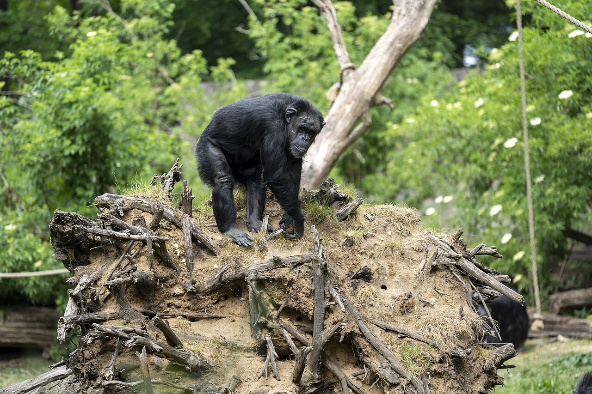{fig-alt="Photograph of a chimpanzee."}

[Source of the virus]{.photo-cap}
:::
::: {.photo}
{fig-alt="Photograph of a white delivery van."}

[The van: a courier, not the medicine]{.photo-cap}
:::
:::
:::
::::

::: {.cite}
@voysey2021
:::

::: {.notes}
This is the Oxford/AstraZeneca vaccine. A vector is a virus turned into a delivery van: we delete its copying genes and load a gene we want cells to read. Why a chimp virus? Many people carry antibodies to human adenoviruses, which would stop the van. The van was off the shelf; only the sequence changed. Question: "Does it infect you?" No, it cannot copy itself. It only delivers the spike gene.
:::

## Vaccine 2: No Virus at All {.k-violet}

:::: {.columns}
::: {.column width="52%"}
Just the message, wrapped in a fat bubble.

- mRNA with one building block swapped
- Fat droplet carries it into cells

[4,284 nucleotides]{.metric}

::: {.part-img .lnp}
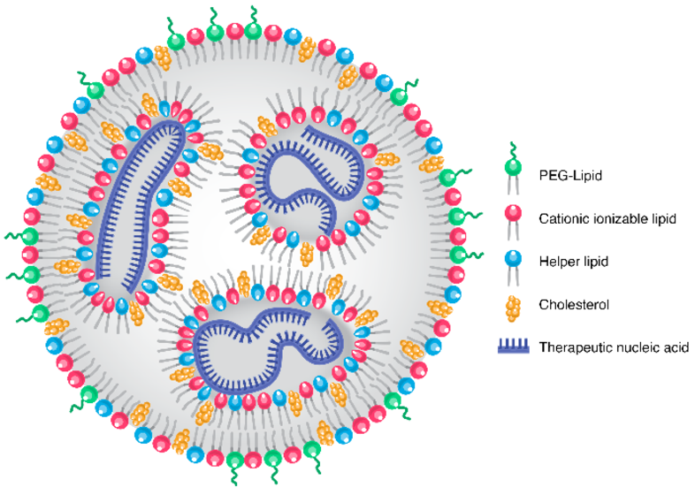{fig-alt="Cross-section of a lipid nanoparticle: strands of nucleic acid held inside a shell of PEG-lipid, ionizable lipid, helper lipid and cholesterol."}
:::
:::
::: {.column width="48%"}
Designed in **days** from the virus genome.

::: {.portrait-row}
::: {.portrait}
{fig-alt="Portrait of Uğur Şahin"}

[Uğur Şahin]{.portrait-name}[BioNTech]{.portrait-role}
:::
::: {.portrait}
{fig-alt="Portrait of Özlem Türeci"}

[Özlem Türeci]{.portrait-name}[BioNTech]{.portrait-role}
:::
:::
:::
::::

::: {.cite}
@polack2020
:::

::: {.notes}
Take the virus away and the sequence still works. Link to the central dogma: we hand the cell the mRNA, and ribosomes make spike. It never enters the nucleus or changes your DNA. The mRNA is fragile, so a lipid nanoparticle (a tiny fat bubble) carries it in. "Swapped how?" That is the next slide.
:::

## One Swap Calms the Cell {.k-violet}

:::: {.columns}
::: {.column width="58%"}
Your **innate immune system** treats plain mRNA as **infection** and destroys it.

Swapping every uridine for **N1-methylpseudouridine** quiets the alarm.

[Same message, different chemistry: the alarm stays quiet.]{.bang}

::: {.viz-stage data-viz="swap" data-caption="Uridine becomes N1-methylpseudouridine." data-prevent-swipe="true" style="height:380px"}
:::
:::
::: {.column width="42%"}
::: {.portrait-row}
::: {.portrait}
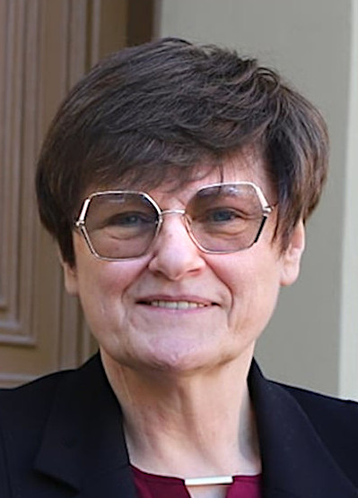{fig-alt="Portrait of Katalin Karikó"}

[Katalin Karikó]{.portrait-name}[with Drew Weissman — Nobel Prize, 2023]{.portrait-role}
:::
:::
:::
::::

::: {.cite}
@polack2020
:::

::: {.notes}
Think of immune receptors as locks and chemical patterns on microbes as keys. Unmodified RNA looks viral, because human cells modify their own RNA. Karikó and Weissman kept the message and changed the feature the sensor looks for. The protein is identical. We meet this same trick again later, with CpG in DNA.
:::

## Muscular Dystrophy: A Gene Cut to Fit {.k-violet}

:::: {.columns}
::: {.column width="52%"}
Duchenne muscular dystrophy: muscle breaks down without dystrophin.

- A virus (AAV) carries the gene to muscle
- A **shortened** dystrophin
- The full gene (11 kb) does not fit

[≈5 kb cassette: gene plus switch]{.metric}
:::
::: {.column width="48%"}
::: {.plate}
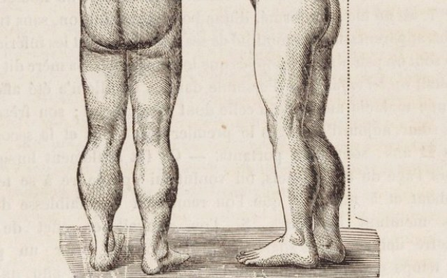{fig-alt="Nineteenth-century engraving showing calf pseudohypertrophy in a child with Duchenne muscular dystrophy."}
:::

[Calf swelling, from Duchenne's 1868 plates.]{.portrait-role}

[The van is fixed. The cargo was redesigned.]{.bang}
:::
::::

::: {.cite}
@mendell2023
:::

::: {.notes}
AAV can hold only about 4.7 kb, but dystrophin is 11 kb. So the therapy uses a shortened version that keeps the key linking parts. A physical limit dictated a biological design, like a suitcase weight limit. It is a working compromise, not a full cure.
:::

## Cancer Antibody: The Odd One Out {.k-violet}

:::: {.columns}
::: {.column width="52%"}
No virus: a protein made in cultured cells.

- Blocks PD-1, a brake on T cells
- Mouse binding regions on a human frame

[≈1.4 kb of coding sequence]{.metric}
:::
::: {.column width="48%"}
::: {.portrait-row}
::: {.portrait}
{fig-alt="Portrait photograph of Jimmy Carter, taken in 2014."}

[Jimmy Carter]{.portrait-name}[Announced metastatic melanoma in August 2015; clear scans by December]{.portrait-role}
:::
:::

Spread melanoma, treated with surgery, radiosurgery and this antibody.

[The product is a protein. The asset is the sequence.]{.bang}
:::
::::

::: {.cite}
@emancipator2020; @goldberg2016
:::

::: {.notes}
This is pembrolizumab (Keytruda). Some tumours press the PD-1 brake so T cells stop attacking. The antibody binds PD-1 like a key in a lock and releases the brake. It began in a mouse, so we graft its binding loops onto a human antibody. Did it cure Carter? He had three treatments at once, so his case alone cannot say. Trials show lasting responses.
:::

## Four Sequences, Same Scale {.k-violet .webonly}

::: {.viz-stage data-viz="seqscale" data-prevent-swipe="true" style="height:560px"}
:::

[Length does not predict impact. The design problem is the same.]{.bang}

::: {.notes}
Let the blocks fill first. Each bead is one hundred bases. The vaccine vector is about twenty-five times longer than the antibody sequence, yet size predicts nothing. Choosing a sequence is a search problem, far too big to try exhaustively. That is the whole talk.
:::
# The Virus Worth Borrowing {.act .k-teal}

AAV cannot copy itself alone. That defect is why we use it.

## Success 1: Blindness {.k-teal}

:::: {.columns}
::: {.column width="55%"}
**Problem.** Without the *RPE65* gene, light-sensing cells die.

**AAV carries.** A working *RPE65* copy, injected under the retina. **Luxturna, 2017.**

**Result.** People could cross an obstacle course in dim light again.

[First US-approved gene therapy for an inherited disease.]{.bang}
:::
::: {.column width="45%"}
::: {.plate}
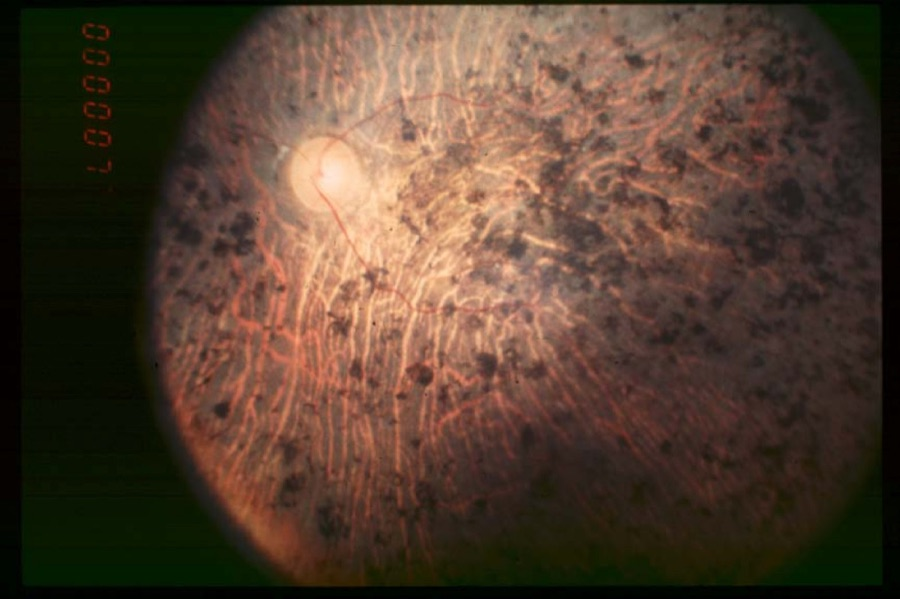{fig-alt="Photograph of the back of the eye showing a retina in advanced degeneration, with dark pigment clumps and thinned vessels."}
:::

[A retina in advanced degeneration. Photo: Christian Hamel, CC BY 2.0.]{.portrait-role}
:::
::::

::: {.cite}
@fda2026products
:::

::: {.notes}
A recessive loss-of-function disease: no working gene copy, so no working enzyme. Gene therapy adds a working copy. The photo shows general retinal degeneration, not specifically RPE65 disease. The eye is small and shielded, so a tiny dose stays put.

Student question: "Is it permanent?" Benefit has lasted years; lifetime is unknown.
:::

## Success 2: Weak Muscles {.k-teal}

:::: {.columns}
::: {.column width="55%"}
**Problem.** Without *SMN1*, the nerves that move muscles die.

**AAV carries.** A working *SMN1* gene, in one drip into a vein. **Zolgensma, 2019.**

**Result.** Treated babies have sat up, and many have walked.

[One drip, not lifelong treatment.]{.bang}
:::
::: {.column width="45%"}
::: {.plate}
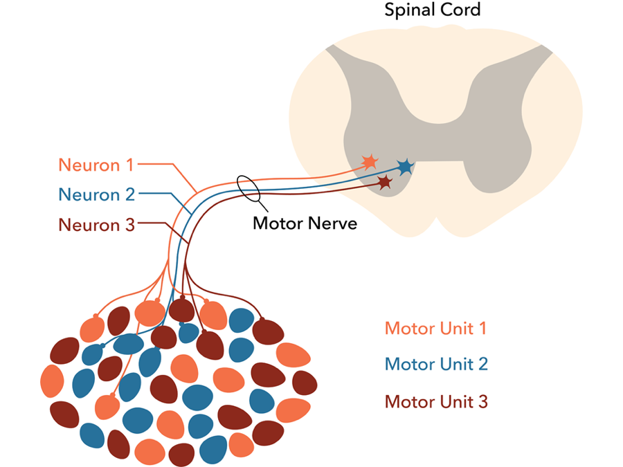{fig-alt="Diagram of motor neurons in the spinal cord sending nerves to groups of muscle fibres."}
:::

[Nerve cells in the spinal cord drive muscles. Diagram: Walsh and Sved, CC BY-SA 4.0.]{.portrait-role}
:::
::::

::: {.cite}
@fda2026products
:::

::: {.notes}
The muscle is fine; the nerve telling it to move is dying. AAV9 can cross from blood into the nervous system. Treat early, because dead neurons are not replaced.

Student question: "Why a vein?" For babies, the blood route is simplest.
:::

## Success 3: Blood That Cannot Clot {.k-teal}

:::: {.columns}
::: {.column width="55%"}
**Problem.** In haemophilia B, the liver lacks clotting factor IX.

**AAV carries.** A working factor IX gene, in one drip. The liver makes the protein. **Hemgenix, 2022.**

**Result.** Bleeding fell and most people stopped regular injections.

[The patient's own liver becomes the factory.]{.bang}
:::
::: {.column width="45%"}
::: {.plate}
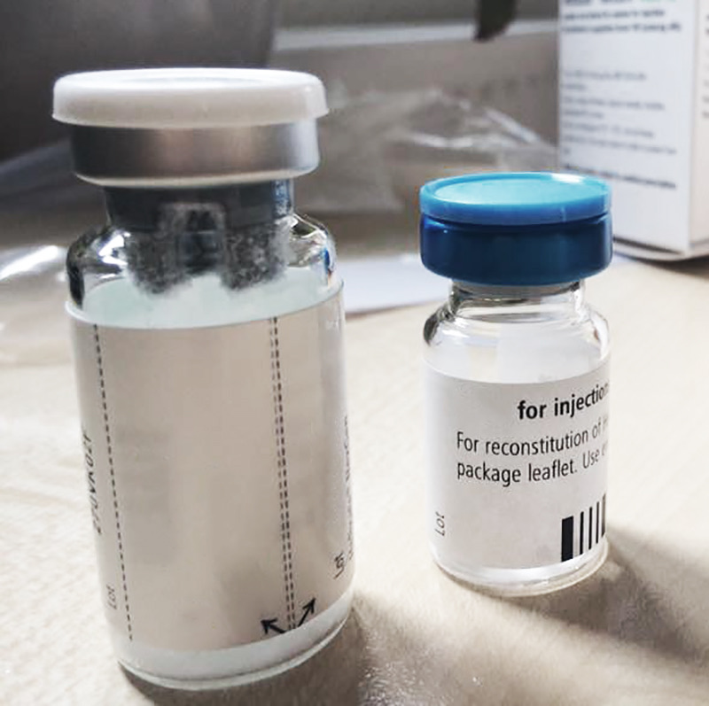{fig-alt="Photograph of two vials of freeze-dried clotting factor concentrate for haemophilia."}
:::

[Clotting-factor concentrate, the lifelong infusion gene therapy aims to replace. Photo: JJEv810, CC BY-SA 4.0.]{.portrait-role}
:::
::::

::: {.cite}
@fda2026products
:::

::: {.notes}
X-linked recessive, as in Mendelian genetics. We add an extra working copy; we do not repair the faulty gene. The vials are factor VIII (haemophilia A), shown only for the infusion burden.

Factor IX is small, 1.4 kb, so it fits in AAV's 4.7 kb space. Remember this size limit; it returns.
:::

## Success 4: Deafness {.k-teal}

:::: {.columns}
::: {.column width="55%"}
**Problem.** Without *OTOF*, ear cells cannot signal to the brain.

**AAV carries.** A working *OTOF* gene, split across two viruses, into the cochlea. **Otarmeni, 2026.**

**Result.** Children who had never heard began to hear speech.

[First approved treatment for genetic deafness.]{.bang}
:::
::: {.column width="45%"}
::: {.plate}
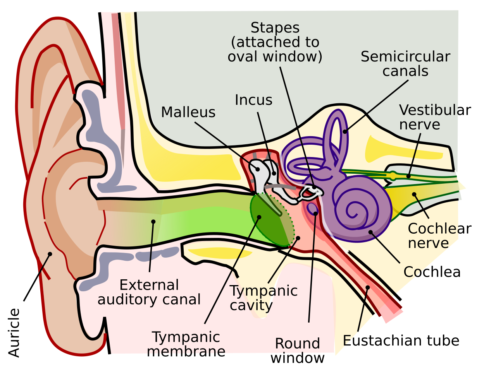{fig-alt="Labelled cross-section diagram of the human ear showing the outer ear, middle ear and the spiral-shaped cochlea."}
:::

[The cochlea is the spiral in the inner ear. Diagram: Chittka and Brockmann, CC BY 2.5.]{.portrait-role}
:::
::::

::: {.cite}
@fda2026products
:::

::: {.notes}
The gene is about 6 kb, over the 4.7 kb limit. So two viruses each carry half, and the halves join inside the cell. Think of a long letter in two envelopes.

Student question: "Does it always work?" Less efficiently than one virus, since both halves must enter the same cell.
:::

## What Is a Virus? {.k-teal .webonly}

:::: {.columns}
::: {.column width="42%"}
A virus is **instructions in a protein shell**.

- **Shell:** protects and sticks to a cell
- **Instructions:** DNA or RNA
- **No machinery:** it borrows yours

[A virus is a delivery van carrying instructions.]{.bang}
:::
::: {.column width="58%"}
::: {.viz-stage data-viz="virusdelivery" data-caption="Shells dock, instructions enter, the cell makes protein." data-prevent-swipe="true" style="height:560px"}
:::
:::
::::

::: {.notes}
One idea: a virus is a parcel of instructions in a shell, and it borrows our machinery. The shell is called the capsid. The bridge: keep the van, swap the instructions. That is gene therapy, and AAV is our van.
:::

## AAV Up Close {.k-teal .webonly}

:::: {.columns}
::: {.column width="40%"}
- DNA genome of 4.7 kb
- Shell (capsid) of 60 protein pieces
- About 26 nm across
- No known disease in humans

[Drag it.]{.bang}
:::
::: {.column width="60%"}
::: {.viz-stage data-viz="capsid" data-pdb="assets/pdb/1lp3.cif" data-assembly="BU1" data-rep="spacefill" data-caption="AAV2, PDB 1LP3: 60 subunits" data-prevent-swipe="true" style="height:620px"}
:::
:::
::::

::: {.cite}
@xie2002
:::

::: {.notes}
A live 3D model of the real AAV2 shell. Turn it to the spikes: they bind the cell's receptor, like lock and key. Everything we engineer later happens on the outside of this object.

Student question: "Does AAV make us ill?" No established disease, which is why it suits medicine.
:::

## Where the Symmetry Is {.k-teal .webonly}

:::: {.columns}
::: {.column width="32%" .tight}
Sixty identical pieces, arranged like a 20-sided ball.

- [**5-fold** ×6: a channel]{style="color:#f472b6"}
- [**3-fold** ×10: the spikes]{style="color:#fbbf24"}
- [**2-fold** ×15: a dip]{style="color:#38bdf8"}
:::
::: {.column width="68%"}
::: {.viz-stage data-viz="capsid" data-pdb="assets/pdb/1lp3.cif" data-assembly="BU1" data-rep="spacefill" data-opacity="0.45" data-axes="5,3,2" data-spin="0.1" data-caption="Symmetry axes computed from the structure" data-prevent-swipe="true" style="height:600px"}
:::
:::
::::

::: {.cite}
@xie2002
:::

::: {.notes}
Point at the three axis types. Five-fold: a pore the genome passes through. Three-fold: the spikes, where the virus binds cells and antibodies attach; most engineering happens here. Two-fold: a shallow dip. Message: not every place on the shell is equal.
:::

## From DNA to Protein {.k-teal}

::: {.viz-stage data-viz="dogma" data-caption="DNA, then RNA, then amino acids, then protein." data-prevent-swipe="true" style="height:380px"}
:::

::: {.dogma-labels}
::: {}
**DNA** the stored copy
:::
::: {}
**RNA** a working copy
:::
::: {}
**Amino acids** one per codon
:::
::: {}
**Protein** the folded machine
:::
:::

[Same colours, same codons: DNA is read into RNA, RNA into amino acids, and the chain folds.]{.bang}

::: {.notes}
Central dogma in one picture. Follow one colour left to right: a three-base codon on the DNA is copied into RNA (transcription), the ribosome reads that RNA codon and adds one amino acid (translation), and the finished chain folds into a protein. Base counts are cut down for the slide. This is the route AAV's genes take, so the next slide's rep and cap are DNA that become proteins this way.
:::

## The Genome at a Glance {.k-teal}

::: {.diagram}
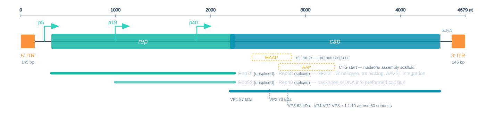{fig-alt="Scale map of the wild-type AAV2 genome showing the two ITRs, the p5, p19 and p40 promoters, the rep and cap open reading frames, and the nested AAP and MAAP accessory reading frames."}
:::

Two genes: *rep* copies and packages. *cap* builds the shell. Short DNA hairpins (ITRs) mark each end.

::: {.cite}
@samulski2014
:::

::: {.notes}
Do not read this out. Point at the ITRs: hairpin ends the cell uses as copy and packaging labels. Then *rep* and *cap*. A promoter is the on-switch before a gene, as in the lac operon.
:::

## Rep Proteins We Throw Away {.k-teal}

:::: {.columns}
::: {.column width="50%"}
**Rep78 and Rep68**

Start copying. They can also insert viral DNA at one spot on chromosome 19.

**Rep52 and Rep40**

Motors that pull the genome into the shell.
:::
::: {.column width="50%"}
The numbers are sizes in kilodaltons.

[Delete *rep* and the virus loses its fixed insertion site.]{.bang}
:::
::::

::: {.cite}
@kotin1990
:::

::: {.notes}
Alternative splicing, as students know: p5 gives Rep78 (unspliced) and Rep68 (spliced); p19 gives Rep52 and Rep40. Medical vectors drop *rep*. That avoids random insertion and cancer risk. The DNA floats free as a loop, so the effect fades where cells divide.

Student question: "Does the gene enter my chromosomes?" Mostly not, by design.
:::

## Three Shell Proteins {.k-teal}

:::: {.columns}
::: {.column width="50%"}
One gene, three versions.

| | | |
|---|---|---|
| **VP1** | 87 kDa | has a membrane-breaking tail |
| **VP2** | 73 kDa | not essential |
| **VP3** | 62 kDa | most of the shell |

:::
::: {.column width="50%"}
Ratio about **1 : 1 : 10**.

[Five VP1 copies let the virus escape the endosome.]{.bang}
:::
::::

::: {.cite}
@girod2002
:::

::: {.notes}
All three come from one gene with different start points. The cell swallows the virus into a bubble, the endosome. VP1's hidden tail, an enzyme that cuts membranes, is exposed when the bubble turns acidic. That frees the virus. The ratio is 1:1:10, not 1:1:5.
:::

## Two Hidden Genes {.k-teal}

:::: {.columns}
::: {.column width="50%"}
**AAP**

Hidden inside *cap*. Helps build the shell.

**MAAP**

A different reading frame of the same DNA. Helps the virus leave the cell.
:::
::: {.column width="50%"}
A 2019 mutation scan revealed MAAP.

[A gene nobody had spotted emerged from the data.]{.bang}
:::
::::

::: {.cite}
@sonntag2010; @ogden2019
:::

::: {.notes}
DNA is read in triplets, so shifting one letter gives a different protein. Viruses overlap genes to save space. Ogden and colleagues mutated the shell gene letter by letter. The results did not fit one reading frame, and MAAP emerged. Hold this thought for mutational scanning later.
:::

## Defective by Design {.k-teal}

:::: {.columns}
::: {.column width="50%"}
AAV needs a **helper virus** to copy itself.

**Adenovirus**, a cold virus, can help.

**Herpes simplex virus** can too.
:::
::: {.column width="50%"}
For medicine, this is a feature:

- In the lab, helper genes come on a **plasmid** (a small DNA circle)
- A vector that cannot copy cannot spread

[Not copying itself is the safety feature.]{.bang}
:::
::::

::: {.cite}
@samulski2014
:::

::: {.notes}
The pivot of the section: dependence on a helper looks like a weakness but is the safety argument. AAV is a parasite of other viruses. The lab supplies helper genes on a plasmid instead.

Student question: "Could an adenovirus infection make it spread?" The vector carries no *rep* or *cap*, so no.
:::

## Why Not Adenovirus? {.k-teal}

:::: {.columns}
::: {.column width="50%"}
**Good vaccine**

- Carries a larger gene
- Strong gene expression
- Strong immune response
:::
::: {.column width="50%"}
**Poor gene therapy**

- Immune system kills treated cells
- Many people already have antibodies
- Inflammation at therapeutic doses
:::
::::

A vaccine wants an immune response. Gene therapy does not.

::: {.cite}
@dunbar2018
:::

::: {.notes}
Seroprevalence: how many people carry antibodies to a virus. Memory means a fast, strong second response, and the vector is neutralised on arrival. One caveat: AAV is only relatively quiet. At high blood doses it is not silent. We return to this.
:::

## Serotypes: Same Shell, New Surface {.k-teal .webonly}

:::: {.columns}
::: {.column width="32%" .tight}
Same fold, same 60 pieces. Only the outer loops differ.

- **AAV2** sticks to heparan sulfate
- **AAV9** sticks to galactose

[Surface loops decide which tissue a virus reaches.]{.bang}
:::
::: {.column width="34%"}
::: {.viz-stage data-viz="capsid" data-pdb="assets/pdb/1lp3.cif" data-assembly="BU1" data-rep="spacefill" data-caption="AAV2, PDB 1LP3" data-prevent-swipe="true" style="height:560px"}
:::
:::
::: {.column width="34%"}
::: {.viz-stage data-viz="capsid" data-pdb="assets/pdb/3ux1.cif" data-assembly="BU1" data-rep="spacefill" data-caption="AAV9, PDB 3UX1" data-prevent-swipe="true" style="height:560px"}
:::
:::
::::

::: {.cite}
@xie2002; @dimattia2012; @summerford1998; @shen2011
:::

::: {.notes}
A serotype is a variant defined by antibody recognition. Tropism is which cells it enters: shell loops are the ligand, cell-surface sugars the receptor. Both shells share a fold, like two enzymes of one family. So we edit loops, not redesign a fold.

Student question: "Just pick the right serotype?" Often yes; engineering does better.
:::
# From Virus to Vector {.act .k-cyan}

A vector is a virus rebuilt as a delivery van. Every viral gene goes. Only the end "handles" stay.

## Keep Only the End Handles {.k-cyan}

::: {.diagram}
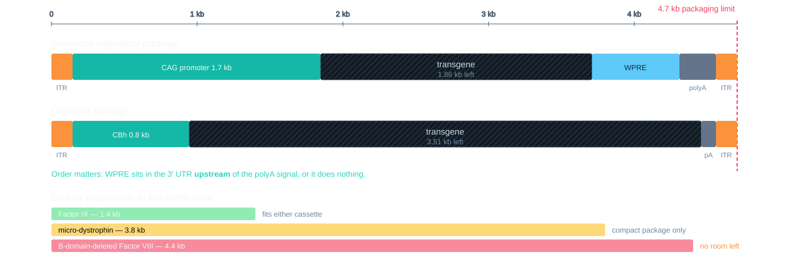{fig-alt="Two recombinant AAV expression cassettes drawn to scale against the 4.7 kb packaging limit, with Factor IX, micro-dystrophin and B-domain-deleted Factor VIII coding sequences drawn to the same scale."}
:::

::: {.cite}
@gray2011; @zantaboussif2009
:::

::: {.notes}
The virus's own genes are gone. What is left is a small cassette between two end sequences (ITRs), which the cell needs to copy and package the DNA. The cassette holds our therapeutic gene plus a promoter, the on-switch.

Everything must fit in one protein shell, the capsid, which holds only about 4.7 kb. Think of a suitcase of fixed size.
:::

## Size Decides the Medicine {.k-cyan}

:::: {.columns}
::: {.column width="50%"}
| Gene to deliver | Size | Fits? |
|---|---|---|
| Factor IX (clotting protein) | 1.4 kb | easily |
| micro-dystrophin (short muscle protein) | 3.8 kb | just |
| Factor VIII (trimmed clotting protein) | 4.4 kb | no room left |
| **dystrophin (full length)** | **11 kb** | **never** |
:::
::: {.column width="50%"}
Duchenne therapy uses a shrunken "micro" dystrophin. Haemophilia A is harder to treat than B.

[A shell's size limit shapes the medicine.]{.bang}
:::
::::

::: {.cite}
@mendell2023
:::

::: {.notes}
Let the table do the work. Dystrophin's gene is about 11 kb, over twice the suitcase, so the therapy delivers a shortened version. Factor IX is small, so haemophilia B got there first. Factor VIII leaves no room for a promoter.

Caveat: micro-dystrophin keeps the key parts but is not the full protein.
:::

## What the Limit Produced {.k-cyan .smaller}

:::: {.columns}
::: {.column width="62%"}
| Product | Delivery virus | Gene delivered | Where it is given |
|---|---|---|---|
| Zolgensma (2019) | AAV9 | *SMN1* 0.9 kb | into a vein |
| Itvisma (2025) | AAV9 | *SMN1* 0.9 kb | into spinal fluid |
| Hemgenix (2022) | AAV5 | *F9* Padua 1.4 kb | into a vein |
| Kebilidi (2024) | AAV2 | *DDC* 1.4 kb | into the brain |
| Fayuvi (2026) | AAV9 | *SGSH* 1.5 kb | into a vein |
| Luxturna (2017) | AAV2 | *RPE65* 1.6 kb | under the retina |
| Elevidys (2023) | AAVrh74 | micro-dystrophin 3.8 kb | into a vein |
| Otarmeni (2026) | **AAV1 × 2** | *OTOF* 6.0 kb | into the inner ear |
:::
::: {.column width="38%"}
Sorted by gene size. Only the last is too big.

*OTOF* is **6 kb**, so it is split across **two vectors**. The cell stitches it back together.

[The limit did not move. The design did.]{.bang}
:::
::::

::: {.cite}
@fda2026products; @fda2026otarmeni
:::

::: {.notes}
Read down the gene sizes: all but one are small, as the limit predicts. The number after AAV names the serotype, a shell variant that targets different tissues.

Otarmeni (2026) treats deafness from *OTOF* faults using two vectors, each with half the gene. The cost is a second vector and needing both halves in one cell.

Under the retina, in the brain and in the ear, the dose is small and stays put.
:::

# Getting In {.act .k-amber}

Between injection and a working gene, most of the dose is lost.

## From Needle to Cell {.k-amber}

::: {.diagram}
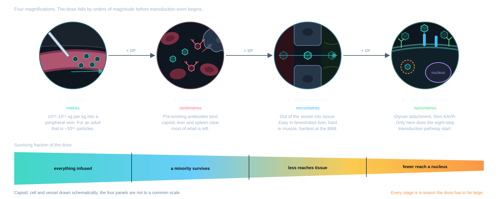{fig-alt="The journey of an AAV dose from the infusion needle to the target cell in four magnifications — infusion into a vein, circulation where antibodies and liver and spleen clearance remove most of the dose, extravasation across the vessel wall, and arrival at the cell surface — with a tapering band showing the surviving fraction collapsing at every stage."}
:::

::: {.cite}
@mingozzi2013
:::

::: {.notes}
Most of the dose is lost on the way. Many people already carry antibodies that block AAV, so trials screen for them, and a second dose usually fails. The liver and spleen mop up particles. The vessel wall is also a barrier.

The tapering band is illustrative; no single percentage is reliable. So doses must be huge.
:::

## The Journey In {#aav-cell-journey .k-amber .webonly}

::: {.viz-stage data-viz="celljourney" data-still="assets/diagrams/transduction.svg" data-alt="AAV attaches, enters by endocytosis, escapes vesicular degradation, reaches the nucleus, uncoats, forms duplex DNA and circular episomes, and is transcribed by RNA polymerase II; the mRNA is exported through a nuclear pore and translated by ribosomes into protein." data-prevent-swipe="true" style="height:650px"}
:::

::: {.cite}
@girod2002; @cataldi2010; @nakai2001
:::

::: {.notes}
This is the central dogma in motion. The virus binds a receptor, the cell takes it in, and many particles are digested in lysosomes (the red branch). Survivors reach the nucleus and the shell opens. The DNA becomes double-stranded, is transcribed, and the mRNA is translated into protein.

Press Play, or select a numbered stage to pause. The red branch is not a measured fraction. The route is simplified.
:::

## What Happens to the DNA {.k-amber .webonly}

:::: {.columns}
::: {.column width="34%" .tight}
- Cell copies the second strand
- Repair enzymes join the ends into circles
- Histones wrap the circles

The cell still notices this DNA.
:::
::: {.column width="66%"}
::: {.viz-stage data-viz="episome" data-prevent-swipe="true" style="height:580px"}
:::
:::
::::

::: {.cite}
@nakai2001
:::

::: {.notes}
Four phases: single strand, second strand, circles, then an episome, which is DNA persisting in the nucleus as a small circle. Wrapped in histones means it looks like your own DNA.

It is not invisible: the cell's break-sensing proteins detect the hairpin ends. "Tolerated" is accurate; "undetected" is not.

Question: does it integrate? Mostly no.
:::

## From Hairpin to Chromatin {.k-amber}

::: {.diagram}
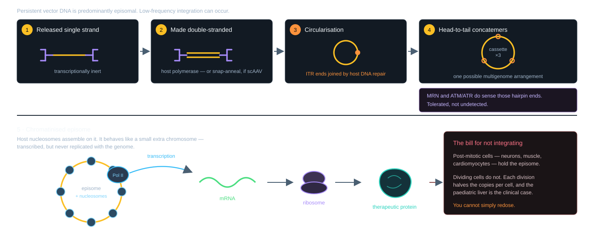{fig-alt="The fate of the delivered AAV genome: the released single strand with its T-shaped ITR hairpins is made double-stranded, host repair can join ITR ends into circular monomers and concatemers, and the circle is wrapped in host nucleosomes into a chromatinised episome that RNA polymerase II transcribes into mRNA and the ribosome translates into the therapeutic protein."}
:::

::: {.cite}
@nakai2001
:::

::: {.notes}
The still version of the animation. The strand arrives folded into hairpins. The cell builds the second strand and repair enzymes join the ends into circles. Histones assemble, and it is transcribed like any gene.

The DNA is read but never copied. Fine in non-dividing cells; in a growing liver, copies dilute.
:::

## Why Expression Fades {.k-amber}

:::: {.columns}
::: {.column width="50%"}
The circle is **not copied** when the cell divides.

**Non-dividing cells** (neurons, muscle): circles can last.

**Dividing cells** (a child's liver): the vector is diluted.
:::
::: {.column width="50%"}
The price of deleting *rep*, the gene that let the virus integrate.

Safety gained; permanence lost.

[Lasting for decades is untested.]{.bang}
:::
::::

::: {.cite}
@nakai2001
:::

::: {.notes}
Link to DNA replication: the circle has no origin of replication the cell uses, so at mitosis copies are shared out and diluted. Neurons never divide, so nothing dilutes.

Do not promise lifelong expression. A first dose raises antibodies, so redosing usually fails.

Why delete rep? Integration carries its own safety risk.
:::
# Making It at Scale {.act .k-green}

One patient needs trillions of virus particles. That is a factory job.

## Two Ways to Grow the Virus {.k-green}

::: {.diagram}
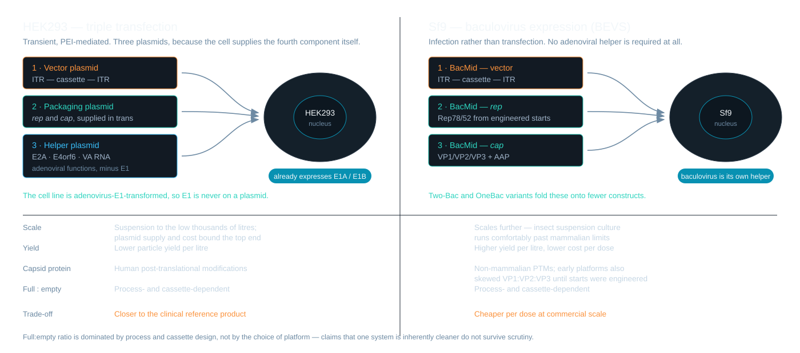{fig-alt="HEK293 triple transfection compared with the Sf9 baculovirus expression system, showing the genetic components each platform delivers and a comparison of scale, yield and capsid protein modification."}
:::

::: {.cite}
@urabe2002
:::

::: {.notes}
Think of cell culture from a practical, just on a huge scale. A cell needs three sets of instructions: the gene with its end sequences, the virus's own protein genes, and helper genes.

In human cells we transfect plasmids in. In insect cells, a second virus, baculovirus, carries them in.

Which gives cleaner batches? The evidence does not support a clear winner. Process and gene design matter more than cell type.
:::

## Henrietta Lacks: Where Cell Lines Began {.k-green}

:::: {.columns}
::: {.column width="52%"}
**1951, Baltimore.** Henrietta Lacks, 31, is treated for cervical cancer. A doctor takes a tumour sample. **Nobody asks her.**

Her cells **kept dividing in a dish**. They became **HeLa**.

[The first human cells that would not die.]{.bang}
:::
::: {.column width="48%"}
::: {.portrait-row .large}
::: {.portrait}
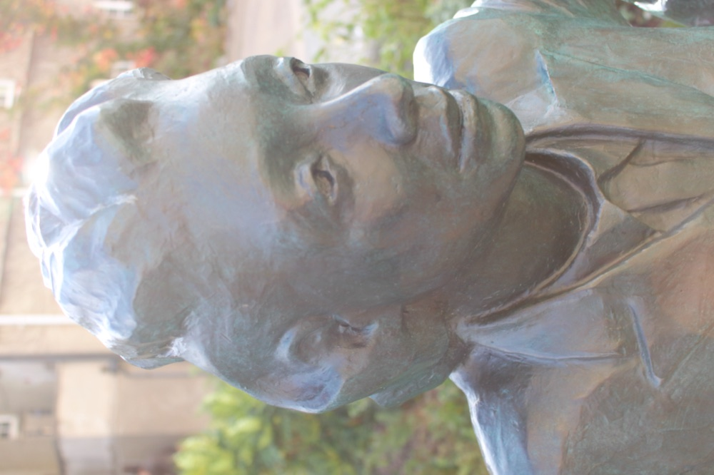{fig-alt="Close-up of the bronze statue of Henrietta Lacks in Bristol, showing her face in profile."}

[Statue of Henrietta Lacks, Bristol. Photo: 14GTR, CC BY-SA 4.0.]{.portrait-role}
:::
::: {.portrait}
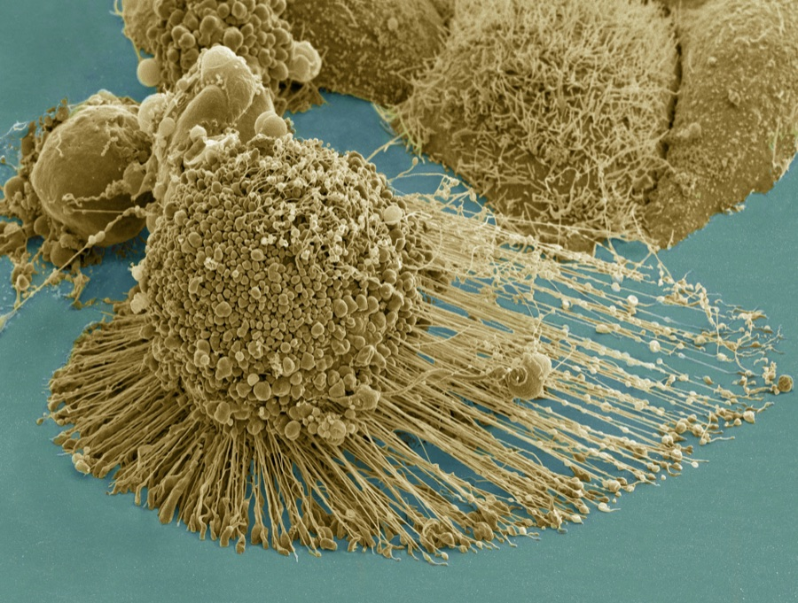{fig-alt="False-colour scanning electron micrograph of a HeLa cell with long filaments spreading across the surface beneath it."}

[A HeLa cell, scanning electron micrograph. Photo: NIH, public domain.]{.portrait-role}
:::
:::
:::
::::

::: {.notes}
Our factory runs on cultured human cells, and cell lines start with her.

She was treated in 1951 and died that year. Her tumour cells did not die, so labs never ran out. HeLa helped test the polio vaccine.

Neither she nor her family were asked or told. That was legal then, and it shaped today's consent rules.

Is AAV made in HeLa? No, it is HEK293, from embryonic kidney.
:::

## Purifying the Virus in Three Steps {.k-green}

::: {.diagram}
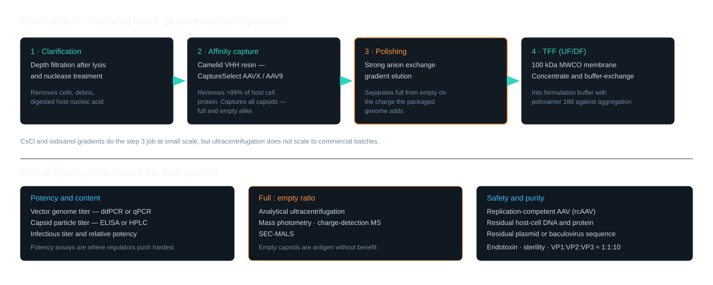{fig-alt="The rAAV downstream purification train — clarification, camelid VHH affinity capture, anion exchange polishing to separate full from empty capsids, and tangential flow filtration — followed by the critical quality attributes."}
:::

::: {.cite}
@mingozzi2013
:::

::: {.notes}
Like purifying a protein from a lysate: capture, polish, concentrate.

Capture uses beads that stick to the virus shell, like an antibody to its antigen. But the beads cannot tell full shells from empty ones.

Polishing removes the empty ones, using a small charge difference. Ultracentrifuges do this on the bench, but not at factory scale.
:::

## Why Empty Capsids Matter {.k-green}

:::: {.columns}
::: {.column width="52%"}
An empty capsid is a shell with no gene. The body still sees it.

- Foreign protein for immunity to attack
- Uses up the patient's tolerance
- Counts towards the dose
:::
::: {.column width="48%"}
Every batch is checked for full versus empty shells.

[Foreign protein, no benefit.]{.bang}
:::
::::

::: {.cite}
@mingozzi2013
:::

::: {.notes}
This bridges into immunology. The immune system reacts to the shell, and cannot tell full from empty.

So each empty capsid spends part of a limited budget and delivers nothing. A manufacturing quality sets a clinical ceiling.
:::

# The Dose Ceiling {.act .k-coral}

A bigger dose works better, but harms more.

## The Therapeutic Window {.k-coral}

::: {.diagram}
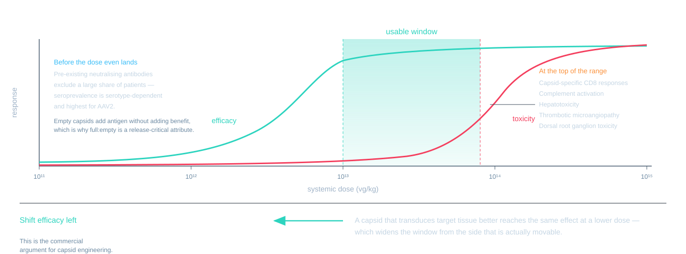{fig-alt="The systemic rAAV therapeutic window, with efficacy and toxicity curves against dose, neutralising antibodies excluding patients at the low end, and capsid T cell responses, complement activation, hepatotoxicity, thrombotic microangiopathy and dorsal root ganglion toxicity bounding the high end."}
:::

::: {.cite}
@manno2006; @hinderer2018
:::

::: {.notes}
This is the hinge of the talk. It is a dose-response curve: one line for benefit, one for harm.

The window between them is narrow. Low end: some patients carry antibodies and are excluded. High end: immune and liver damage.

We cannot move the harm curve much. We can shift benefit left with a better capsid. That is why capsid engineering matters.
:::

## Three Ways the Dose Fails {.k-coral}

:::: {.columns}
::: {.column width="33%"}
**Before treatment**

**Neutralising antibodies** block the virus. These patients cannot be treated.
:::
::: {.column width="33%"}
**At the right dose**

**Killer T cells** destroy liver cells showing viral protein. Gene expression falls.
:::
::: {.column width="34%"}
**Above the right dose**

**Complement** (blood proteins that attack foreign surfaces), plus liver and nerve damage.
:::
::::

::: {.cite}
@mingozzi2013; @faust2013; @hinderer2018
:::

::: {.notes}
Walk left to right. Many people met natural AAV and made antibodies, which is immune memory. They block the vector from entering cells.

Middle: in the first haemophilia B trial, clotting Factor IX rose then fell. A T cell response to the capsid removed the treated liver cells.

Right: high doses activate complement and injure liver and nerves. These set today's ceiling.
:::
# Engineering the Modules {.act .k-magenta}

We can redesign three parts of a gene therapy vector: the shell, the switch and the DNA ends.

## Three Parts, Three Problems {.k-magenta}

:::: {.columns}
::: {.column width="33%"}
::: {.part-img .dark}
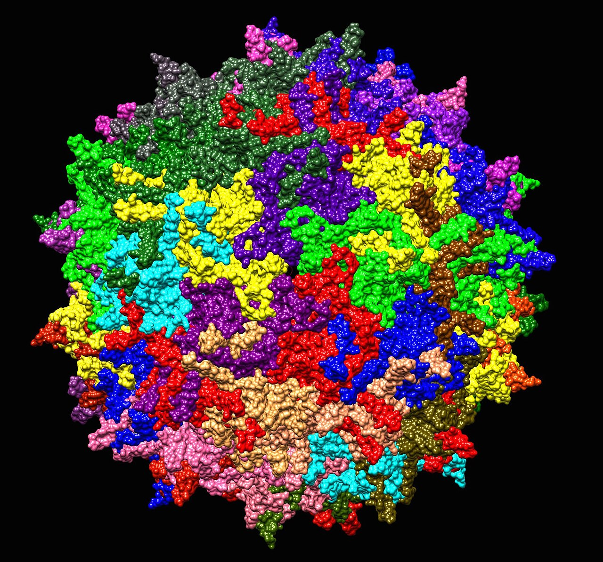{fig-alt="Surface of the AAV2 capsid, computed from crystal structure 1LP3, with one five-fold axis centred."}
:::

**Capsid**

The protein shell. It picks the target cells and dodges antibodies.

*A protein-surface problem.*
:::
::: {.column width="33%"}
::: {.part-img}
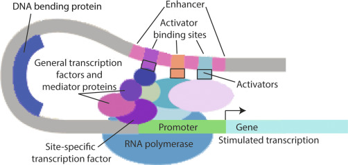{fig-alt="Diagram of an enhancer looping DNA so that activators and general transcription factors sit on the promoter and RNA polymerase starts the gene."}
:::

**Promoter**

The DNA switch. It sets where, and how strongly, the gene turns on.

*A gene-regulation problem.*
:::
::: {.column width="34%"}
::: {.part-img}
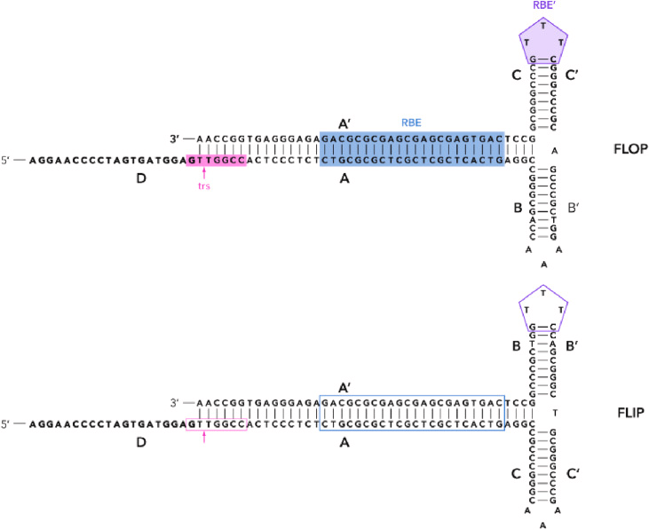{fig-alt="Base-by-base diagram of the AAV inverted terminal repeat folded into a T-shaped hairpin, in its flop and flip forms."}
:::

**ITR**

Short DNA repeats at both ends. They help packaging and persistence.

*A DNA-shape problem.*
:::
::::

::: {.notes}
You know promoters from gene regulation; a capsid is the virus's protein coat. ITRs are short repeats at each end of the vector's DNA. They help pack it and keep it in the cell.

These are three different problems, so they need different methods. We spend longest on the capsid, which has the most data.
:::

## The Search Space Is Huge {.k-magenta .webonly}

:::: {.columns}
::: {.column width="40%" .tight}
The capsid protein has **735 amino acids**. Each can be one of 20.

A 60-residue stretch alone has about 10⁷⁸ possible sequences.
:::
::: {.column width="60%"}
::: {.viz-stage data-viz="seqspace" data-prevent-swipe="true" style="height:560px"}
:::
:::
::::

[Nine orange peaks are measured natural capsids. The rest is untested.]{.bang}

::: {.cite}
@arnold2009
:::

::: {.notes}
Each point is a possible sequence. The nine orange peaks are natural AAV serotypes we have measured. Everything else is dark: nobody has tested it.

In practice we change a short stretch, say seven amino acids: 20 to the 7, about 1.3 billion variants. Each test needs virus made and injected into an animal, so we cannot test them all.
:::

## Capsid Shuffling {.k-magenta .webonly}

::: {.viz-stage data-viz="shuffle" data-prevent-swipe="true" style="height:520px"}
:::

[Parent genes are cut up and reassembled. Each colour is one parent.]{.bang}

Cut up several natural capsid genes. Let them reassemble as mosaics. Keep the ones that work.

::: {.cite}
@grimm2008
:::

::: {.notes}
This is directed evolution: make a diverse library of variants, put it in the target tissue, and keep what gets in. It is natural selection in a test tube.

Shuffling builds the library, like recombination in meiosis swapping blocks between parents. It finds combinations that one-mutation-at-a-time never would.
:::

## What Shuffling Gave Us {.k-magenta}

::: {.diagram}
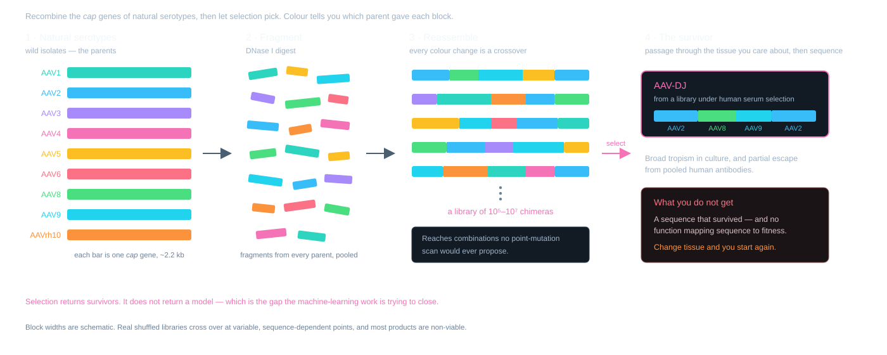{fig-alt="Capsid shuffling in four stages: the cap genes of nine natural serotypes are digested into fragments, the fragments prime on one another and reassemble into a library of chimeras whose coloured blocks show which parent contributed each stretch, and selection returns a single survivor, AAV-DJ, a mosaic of AAV2, AAV8 and AAV9. A panel notes that what you do not get is any function mapping sequence to fitness."}
:::

::: {.cite}
@grimm2008
:::

::: {.notes}
Shuffling gave useful tools, such as AAV-DJ. But we get one winner and no rule linking sequence to performance.

Change tissue and you must start the screen again. Machine learning aims to close that gap.
:::

## One Loop, a Billion Variants {.k-magenta}

::: {.diagram}
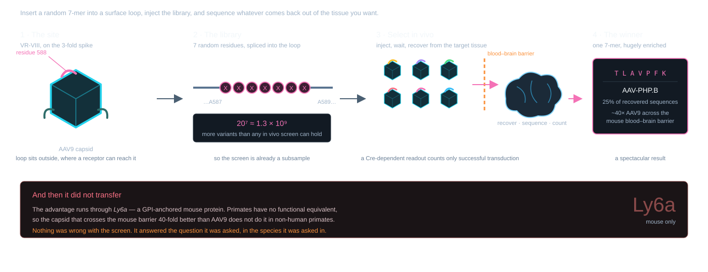{fig-alt="Peptide display in four stages: a random 7-mer is inserted into the VR-VIII loop at residue 588 of AAV9, giving 20⁷ ≈ 1.3 billion variants; the library is injected and recovered from the target tissue; the enriched sequence TLAVPFK defines AAV-PHP.B, which crosses the mouse blood-brain barrier about 40-fold better than AAV9. A band underneath notes the advantage runs through Ly6a, a mouse protein with no functional primate equivalent."}
:::

[It worked in mice. Mice were the wrong model.]{.bang}

::: {.cite}
@deverman2016
:::

::: {.notes}
Insert seven random amino acids into one surface loop, inject into mice, and recover virus from the brain. The winner, AAV-PHP.B, crossed the mouse blood-brain barrier far better.

It failed in primates, because it used a mouse protein, LY6A, that primates lack. The screen did its job; we picked the wrong animal.
:::

## What Is a Model? {.k-magenta}

**Model**: a rule learned from examples that predicts.

**Training**: adjusting the rule to fit the examples.

**Testing**: checking it on examples it has *never seen*.

::: {.notes}
A model takes an input, here a protein variant, and predicts an outcome. Nobody writes the rule; it is learned from data.

Training is like fitting a line to a scatter plot. Testing holds data back, so we know the model has not just memorised, like a student who memorises past papers.
:::

## How a Random Forest Predicts {.k-magenta .webonly}

::: {.viz-stage data-viz="forest" data-prevent-swipe="true" style="height:600px"}
:::

[Follow one variant down three trees. Do they agree?]{.bang}

::: {.cite}
@breiman2001
:::

::: {.notes}
A decision tree is like a field-guide key: yes/no questions ending in an answer. Here the questions are about charge, bulk and so on.

Each tree sees different data, so they disagree a little. Averaging their answers cancels much of the error. The numbers on screen are illustrative.
:::

## From Mouse to Macaque {.k-magenta .webonly}

:::: {.columns}
::: {.column width="33%" .tight}
**Fit4Function**: one model per measurable property.

Six properties, combined.

**88%** of designed variants met all six.
:::
::: {.column width="67%"}
::: {.viz-stage data-viz="crossspecies" data-prevent-swipe="true" style="height:620px"}
:::
:::
::::

[No one predictor carries across species. All six together do.]{.bang}

::: {.cite}
@eid2024
:::

::: {.notes}
This answers the AAV-PHP.B problem. The team screened a library spread evenly, measured six functions, and trained one model for each.

Chart question: do predictions carry over to the macaque? Chance is 0.24. The best single predictor scores 0.86; all six together score 0.91.
:::

## Predict Fitness Before Measuring {.k-magenta}

:::: {.columns}
::: {.column width="52%"}
Can **3D structure alone** predict how well a capsid is *produced*?

No measured AAV data was used to train.
:::
::: {.column width="48%"}
**Threefold** more mutations beat the natural capsid than random ones. *Preprint.*

A capsid you cannot make is no medicine.
:::
::::

[All of this can be calculated from a structure.]{.bang}

::: {.cite}
@mikos2021
:::

::: {.notes}
Most work asks which tissue a capsid reaches. Few ask whether we can make enough of it.

Structure alone, such as how buried a residue is, tripled the hit rate. This is a preprint, not yet peer reviewed, so call it promising, not settled.
:::
## Score or Propose? {.k-magenta}

::: {.diagram}
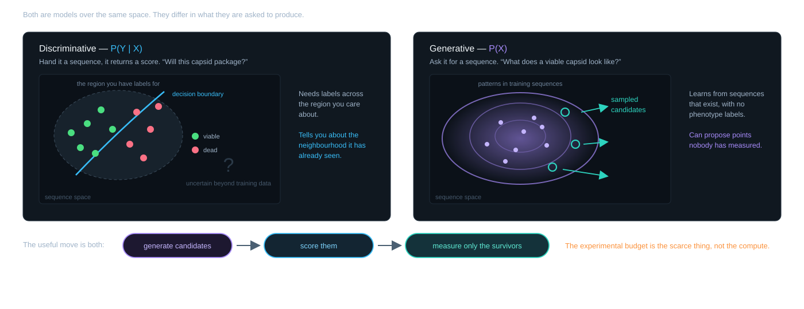{fig-alt="Discriminative versus generative models over sequence space. A discriminative model learns P(Y|X): it draws a boundary through the small labelled region and has uncertain predictions outside its training distribution. A generative model learns P(X), a distribution over training sequences, from sequences without phenotype labels, and new candidates can be sampled from it. A pipeline underneath shows the combination: generate candidates, score them, measure only the survivors."}
:::

::: {.cite}
@ng2001
:::

::: {.notes}
A scoring model judges a variant you hand it, but it needs measured examples, so it guesses far from them. A generative model learns what working sequences look like, from sequences alone, then proposes new ones. Best pipeline: generate, score, then measure only the survivors in the lab.

Question: is it just copying? No, it learns the pattern, so samples are new but familiar.
:::

## What a VAE Does {.k-magenta .webonly}

:::: {.columns}
::: {.column width="36%" .tight}
A **VAE** squeezes, then rebuilds.

**Encoder**: sequence to a few numbers.

**Decoder**: numbers back to a sequence.
:::
::: {.column width="64%"}
::: {.viz-stage data-viz="latent" data-prevent-swipe="true" style="height:560px"}
:::
:::
::::

[Move the marker: the sequence changes smoothly.]{.bang}

::: {.cite}
@ng2001; @bryant2021
:::

::: {.notes}
Like describing a face with a few numbers: width, eye spacing, nose length. The encoder does that for sequences; the decoder rebuilds one. Training keeps similar sequences close, so the map is smooth. Point at the strip: it changes gradually as the marker moves.

Question: do decoded sequences work? Not automatically. They are candidates to test.
:::
## Models That Design Proteins {.k-magenta}

:::: {.columns}
::: {.column width="50%"}
A **generative model** learns patterns from many examples, then writes new ones that fit.

Like autocomplete for proteins.
:::
::: {.column width="50%"}
The examples are sequences nature already made.

The model proposes new ones.
:::
::::

[Data matters more than the type of model.]{.bang}

::: {.cite}
@bryant2021
:::

::: {.notes}
Autocomplete learns how sentences look. Here the sentences are protein sequences. You may hear VAE, GAN or diffusion: different pattern-learners, and you needn't know them. AAV results improved because experiments gave enough measured examples, not because of a fancier model.

Question: is it guessing? It makes educated proposals; the experiment decides.
:::

## Mutate Everything, Measure Everything {.k-magenta}

::: {.diagram}
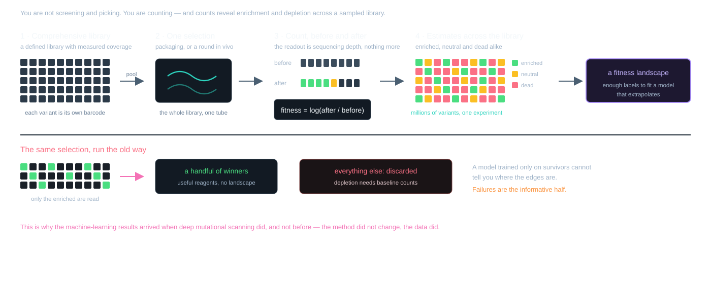{fig-alt="Deep mutational scanning compared with directed evolution. A comprehensive library containing every variant goes through one selection; the population is sequenced before and after, and each variant's fitness is the log ratio of its counts, so enrichment and depletion can be estimated for adequately sampled variants. Directed evolution runs the same selection but reads only the enriched survivors and discards the failures."}
:::

[Count variants before and after: winners rise, losers fall.]{.bang}

::: {.cite}
@ogden2019
:::

::: {.notes}
Change every position to every other amino acid, then test the whole library. Sequence it before and after. A variant's sequence is its name tag: counts up means it works, counts down means it fails. Directed evolution keeps only survivors, like studying only marathon finishers. Models need the failures too.

Caveat: a rare variant can vanish by chance.
:::

## Letting Data Teach the Model {.k-magenta}

::: {.diagram}
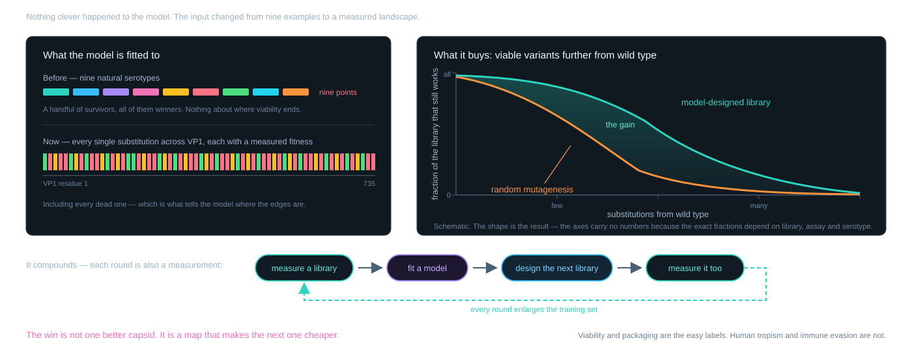{fig-alt="Machine-guided capsid design. The input changed from nine natural serotypes to a comprehensive measured landscape covering every single substitution across VP1. A schematic plot shows the fraction of a library that remains viable against substitutions from wild type: random mutagenesis collapses within a few substitutions while a model-designed library stays viable much further out. A loop underneath — measure, fit, design, measure again — notes that every round enlarges the training set."}
:::

[The model learns what works, instead of us assuming.]{.bang}

::: {.cite}
@ogden2019; @bryant2021
:::

::: {.notes}
Measured scores become training data. The model designs new versions, we measure them, and results feed the next round. Point at the graph: random changes quickly break the capsid, like typos in a manual. A model-designed library survives many more changes.

Caveat: we measure assembly at scale, not targeting or immune escape.
:::

## Promoters: Where a Gene Switches On {.k-magenta}

:::: {.columns}
::: {.column width="50%"}
A **promoter** is DNA beside a gene where transcription starts.

Goal: gene on **only** in the target tissue, in as little DNA as possible.
:::
::: {.column width="50%"}
Why:

- wrong-tissue activity is unsafe
- "on everywhere" can provoke immune attack

[Specificity written into the DNA.]{.bang}
:::
::::

::: {.cite}
@gray2011
:::

::: {.notes}
You know promoters from transcription: where factors land and recruit RNA polymerase. Space in the virus is tiny, so a short promoter leaves more room for the gene. A liver-only promoter gives targeting at the level of gene activity, not delivery.

Question: why not just target delivery? You can, but the promoter adds a second layer.
:::

## Designed Promoters {.k-magenta}

:::: {.columns}
::: {.column width="52%"}
[[Michael Roberts]{.namecard-name}[Synpromics → AskBio → Bayer · now Chromatin Bioscience]{.namecard-role}]{.namecard}

Screened libraries of short binding sites, then assembled the best into small, tissue-selective switches.
:::
::: {.column width="48%"}
**AMT-191**: Fabry disease treatment. A liver-selective promoter drives the *GLA* gene.

First four patients: **27-208 times** normal enzyme activity (company-reported, July 2025).

[Designed, not borrowed.]{.bang}
:::
::::

::: {.cite}
@uniqure2025
:::

::: {.notes}
Fabry patients lack an enzyme, so a substrate builds up. Here the liver is switched on to supply it. The team built a compact liver-selective switch instead of borrowing a viral promoter.

Caveat: four patients, company data. It shows enzyme made, not clinical benefit or safety.
:::

## Why CpG Looks Like Danger {.k-magenta}

::: {.diagram}
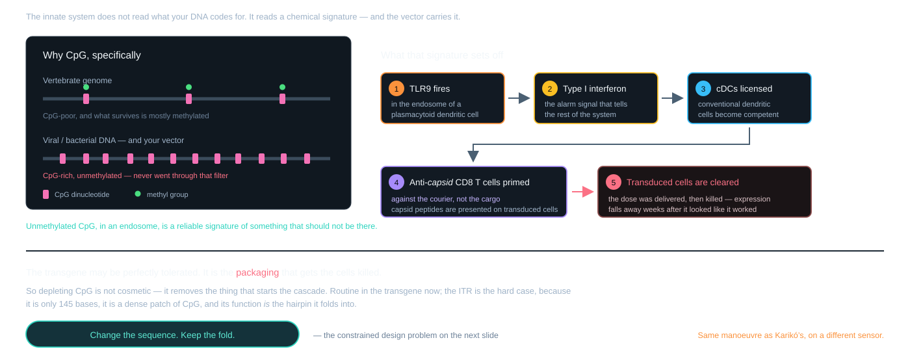{fig-alt="Why CpG reads as danger. Vertebrate DNA is CpG-poor and mostly methylated where CpG remains, while viral and bacterial DNA is CpG-rich and unmethylated, so unmethylated CpG inside an endosome is a signature of non-self. A five-step cascade follows: TLR9 fires in a plasmacytoid dendritic cell, type I interferon is released, conventional dendritic cells are licensed, anti-capsid CD8 T cells are primed, and transduced cells are cleared."}
:::

[An innate alarm turns gene delivery into immune attack.]{.bang}

::: {.cite}
@faust2013; @mingozzi2013
:::

::: {.notes}
Innate immunity spots patterns, not specific pathogens. Unmethylated CpG is one: rare in our DNA, common in bacteria and viruses. TLR9 detects it. Follow the cascade: interferon, dendritic cells, then T cells that kill the treated cells. So removing CpG removes the alarm.

Question: is our DNA never detected? Rarely; it is CpG-poor and methylated.
:::

## Editing Viral Ends Safely {.k-magenta .webonly}

:::: {.columns}
::: {.column width="36%" .tight}
The **ITR** is a short stretch at each end of the viral DNA. It folds into a hairpin that the enzyme **Rep** recognises.

It is also rich in **CpG**.

Only 145 bases.
:::
::: {.column width="64%"}
::: {.viz-stage data-viz="itrcpg" data-prevent-swipe="true" style="height:560px"}
:::
:::
::::

::: {.cite}
@faust2013
:::

::: {.notes}
Watch where the CpG sites sit on the hairpin, and what changing bases does to its shape. The ITR works through its fold, like tRNA, so edits can break it. Rules: cut CpG, keep the fold, keep Rep able to bind.

Question: why not delete it? Without it the genome can't be copied or packaged.
:::

## Where This Goes {.k-magenta}

:::: {.columns}
::: {.column width="50%"}
The limit is the **dose ceiling**: how much virus a patient can safely receive.

A better shell works at a lower dose.
:::
::: {.column width="50%"}
Next steps:

- human-tissue measurements
- models across virus types
- designs that avoid immunity
:::
::::

[Biology sets the rules; the rest is search.]{.bang}

::: {.cite}
@ogden2019; @eid2024
:::

::: {.notes}
The virus is safe because it can't replicate alone and doesn't integrate, but the dose must work first time. Immunity limits the dose, so each particle must do more. Machine learning helps because the design space is huge, and works because of experiments and biology.

Caveat: models predict assembly, not behaviour in human liver. That is the frontier.
:::
## References {.scrollable .smaller}

::: {#refs}
:::

## Credits {.smaller .k-teal}

:::: {.columns}
::: {.column width="50%"}
**Structures** — RCSB PDB. AAV2 [1LP3](https://www.rcsb.org/structure/1LP3), AAV9
[3UX1](https://www.rcsb.org/structure/3UX1). Icosahedral assemblies expanded in-browser
from the deposited asymmetric units.

**Software** — [three.js](https://threejs.org) and [NGL Viewer](https://nglviewer.org),
both MIT, vendored into this repository.

**Diagrams** — drawn for this deck; MIT with the rest of the source.
:::
::: {.column width="50%"}
**Portraits** — via Wikimedia Commons. **CC BY-SA 4.0**:

- Uğur Şahin, Özlem Türeci — © BioNTech SE
- Katalin Karikó — © University of Szeged

Public domain: Jimmy Carter — Lauren Gerson, LBJ Presidential Library, 2014.

**Plate** — Duchenne de Boulogne (1868), public domain.

**Three Parts, Three Problems** — AAV2 capsid surface: Jazzlw, CC BY-SA 4.0, derived from PDB 1LP3, via Wikimedia Commons. Promoter and ITR figures are from the original talk; their sources are not recorded here.

**Vaccine 1 and 2** — chimpanzee: Mira Meijer, Burgers' Zoo, CC BY-SA 4.0; delivery van (Ford Transit Connect): Winnebaggo, CC0; both via Wikimedia Commons. The lipid-nanoparticle diagram is from the original talk; its source is not recorded here.

**HeLa** — statue of Henrietta Lacks, 14GTR, CC BY-SA 4.0; HeLa cell micrograph, NIH, public domain. Via Wikimedia Commons.

**AAV successes** — retina photograph: Christian Hamel, CC BY 2.0; motor-unit diagram: Daniel Walsh and Alan Sved, CC BY-SA 4.0; clotting-factor vials: JJEv810, CC BY-SA 4.0; ear anatomy: Lars Chittka and Axel Brockmann, CC BY 2.5. All via Wikimedia Commons.

**No photograph of an identifiable patient appears here without their own disclosure.**
President Carter announced his diagnosis and his treatment publicly, himself. The
Duchenne figure is an 1868 engraving, not a photograph of a living child.
:::
::::

::: {.notes}
Keep this slide. CC BY-SA 4.0 requires attribution and a licence statement, and the
portraits of Şahin, Türeci and Karikó are all under it.

The last line is deliberate. Using a real, identifiable patient's photograph — especially
a child's — in a conference talk needs explicit consent that a slide deck cannot
evidence. The 1868 engraving carries the same clinical point with none of that problem.

Carter is the one exception and it is a principled one: he held press conferences about
his own diagnosis, his own treatment and his own scans. That is disclosure by the
patient, not disclosure about a patient.
:::

# Questions {.act .k-teal}

::: {.notes}
Likely questions:

- *Why not redose?* The antibody response to dose one blocks it. Plasmapheresis and IgG
  proteases are being tried.
- *Why not integrate deliberately?* Insertional mutagenesis; and rAAV integration is
  largely non-targeted anyway. Nucleases and base editors are the other answer.
- *How real is DRG toxicity?* Consistent across NHP studies, dose dependent, often
  subclinical but histologically unambiguous.
- *Does generative design beat directed evolution?* On viability at distance, yes. On
  human tropism, not yet demonstrated.
- *Why is MAAP interesting?* It is the clearest case of ML on sequence data revealing
  biology rather than just optimising it.
:::
